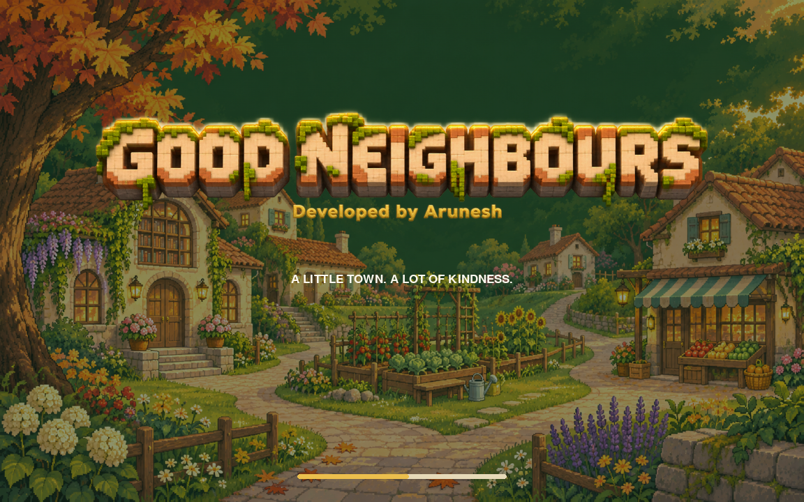
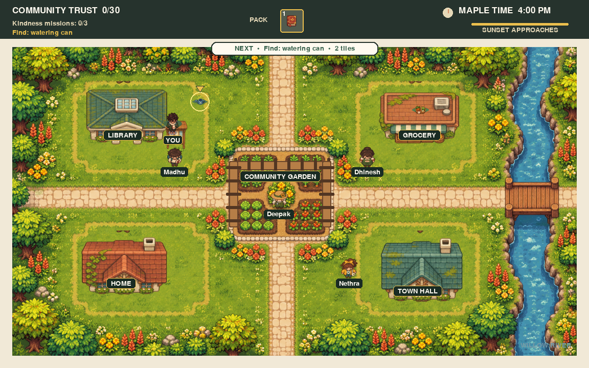
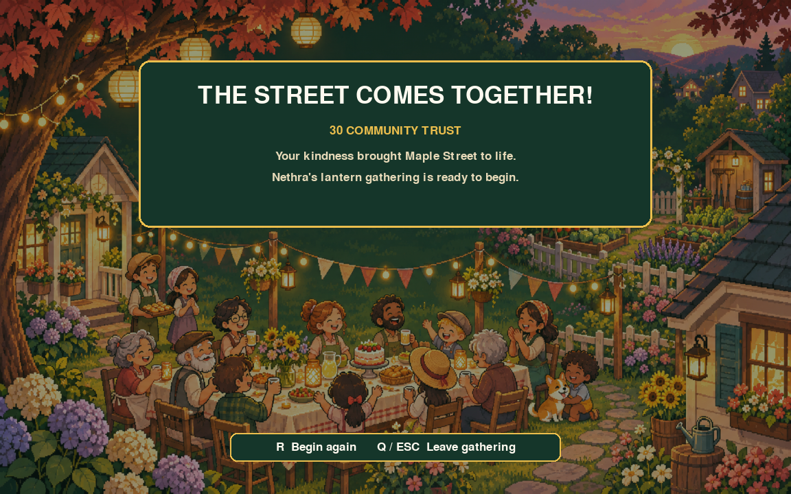
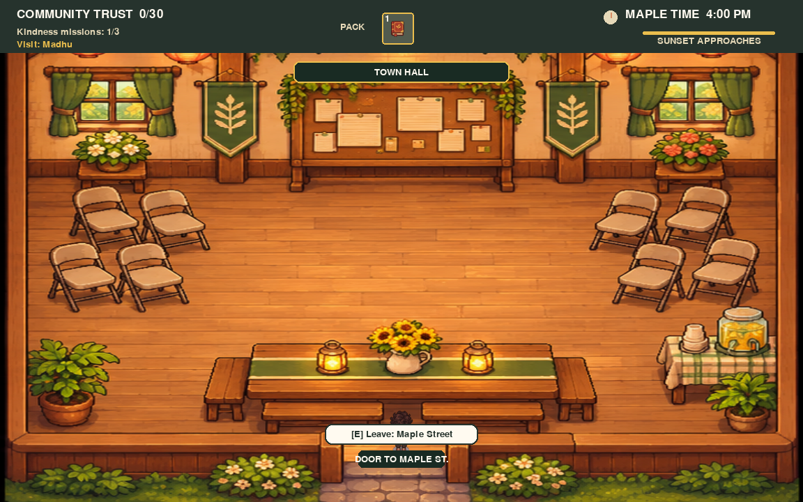
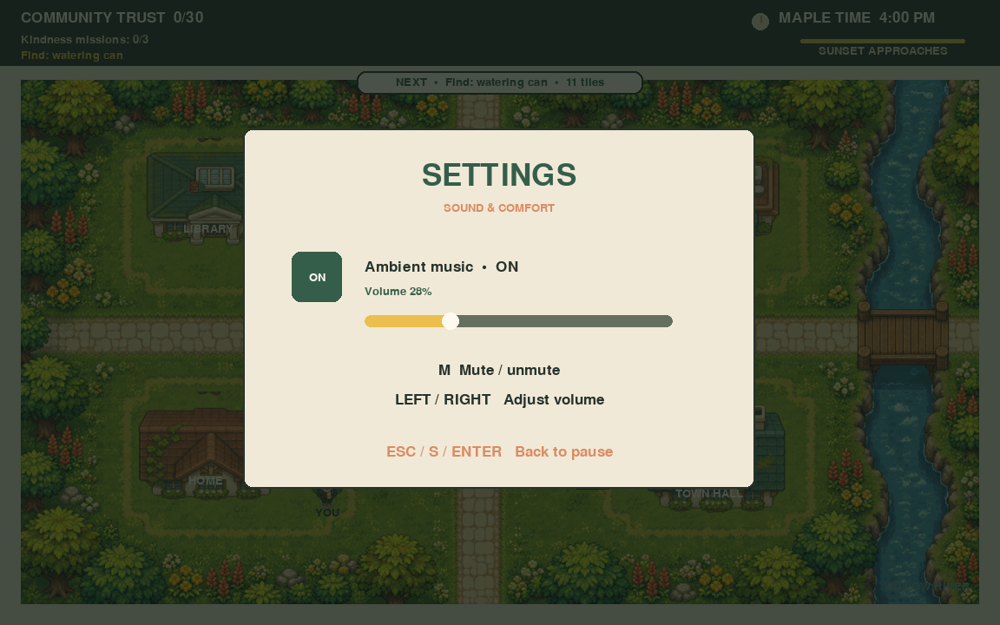
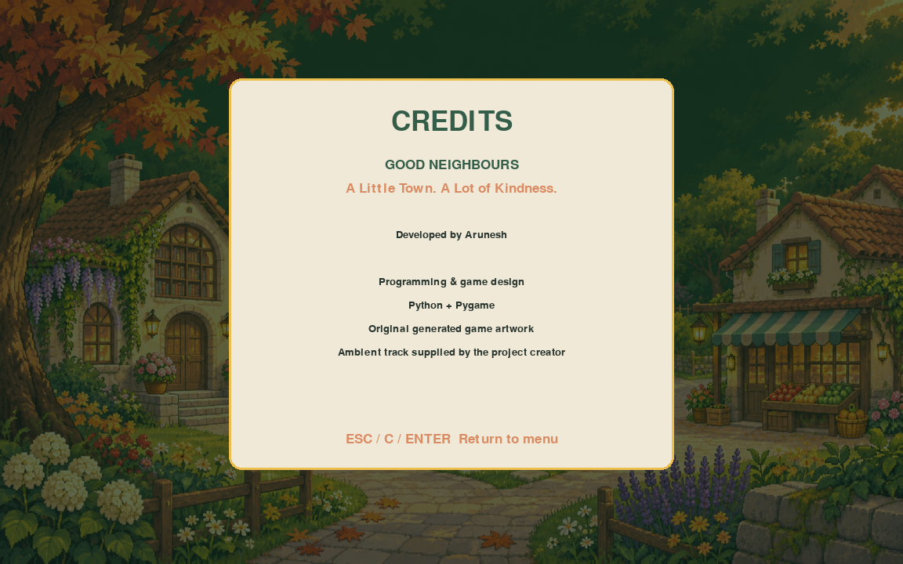

# GOOD NEIGHBOURS

> **A Little Town. A Lot of Kindness.**

[](https://github.com/Z-A-R-R-O/Z-A-R-R-O-game-challenge-RA2611047050004-good-neighbours/actions)
[](LICENSE)



GOOD NEIGHBOURS is a cosy, top-down Python adventure about the kind of heroism that rarely gets a cape: returning a watering can, carrying a book, and showing up when a neighbour needs a hand. On Maple Street, three small favours are enough to turn a quiet afternoon into a lantern-lit community gathering.

*“Kindness is not a side quest. It is the whole quest.”*

## Story

Maple Street used to feel like one big front porch. Recently, everyone has been busy, doors have stayed closed, and the community gathering has almost faded away.

You decide to change that—not with a sword, a dragon, or 300 collectible rocks, but by helping Deepak, Madhu, and Dhinesh before sunset. Each finished task earns **Community Trust** and brings Nethra's lantern gathering closer to life.

## Experience and tone

This is a game about ordinary care. Its dialogue is warm, short, and character-led: residents have worries, small jokes, and reasons to hope, but the writing never asks the player to rush through an emotional moment. Conversations pause the world, then wait for the player to continue.

The humour is deliberately gentle—more misplaced watering cans and self-important cucumbers than punchlines. The aim is to make Maple Street feel lived in while keeping the presentation clear and professional for assessment.

## Features

- A polished main menu, eight-second cinematic loading screen (skippable with `Space`, `Enter`, or `Esc`), Help, Pause, Settings, Credits, Victory, and Game Over screens.
- Top-down Maple Street map with garden, river, bridge, paths, homes, flowers, and landmarks.
- Four enterable interiors: Library, Home, Grocery, and Town Hall.
- Three complete item-delivery missions with one-time rewards and no duplicate score exploits.
- Animated item pickups, guided objective beacon, distance indicator, and dynamic inventory hotbar.
- Portrait cutscenes with typewriter dialogue; conversations pause the clock so nobody has to speed-read.
- In-world Maple Time clock and sunset deadline.
- Ambient music, volume controls, mute toggle, and a fully usable Settings screen.
- A dedicated lantern-gathering victory scene.

## The neighbours

| Neighbour | Need | What it means |
| --- | --- | --- |
| Deepak | A missing watering can | Caring for a shared space |
| Madhu | A Library storybook | Sharing curiosity and stories |
| Dhinesh | A grocery basket | Preparing a table for everyone |
| Nethra | Community Trust | Bringing the gathering together |

## Mission flow

1. Find Deepak's watering can near the old oak and return it.
2. Enter the Library, collect Madhu's storybook, and deliver it.
3. Enter the Grocery, collect Dhinesh's basket, and deliver it.
4. Earn **30 Community Trust** and celebrate at the lantern gathering.

No combat. No punishment for a missed jump. Just neighbours, errands, and a suspiciously important watering can.

## Controls

| Key | Action |
| --- | --- |
| `Space` / `Enter` / `Esc` | Skip cinematic loading screen to menu |
| `W A S D` / arrow keys | Move |
| `E` | Interact, reveal dialogue, or continue dialogue |
| `H` | Open help |
| `P` / `Esc` | Pause |
| `S` | Open Settings from Pause |
| `M` | Mute or unmute music in Settings |
| `Left` / `Right` | Adjust music volume in Settings |
| `C` | Open Credits from the main menu |
| `R` | Restart from a pause/end screen |
| `Q` | Quit |

## Installation and running

### Requirements

- Python 3.10 or newer
- Pygame

### Setup

```bash
python -m pip install -r requirements.txt
python game.py
```

The game supports a project-approved ambient track at `assets/good_neighbours_bg.mp3`. It loops automatically at a gentle volume. If that file is unavailable, the game still runs normally.

## Screenshots

| Loading | Maple Street | Victory |
| --- | --- | --- |
|  |  |  |

More views:

- 
- 
- 

## Technical notes

The project is deliberately built as a clear, explainable Pygame game rather than a giant framework. It demonstrates:

- Classes and dataclasses for game objects.
- Dictionaries, lists, and sets for missions, world data, inventory, and discoveries.
- Delta-time movement and a frame-controlled main loop.
- Rectangle collision for buildings, fences, and the river.
- A state machine for menu, loading, gameplay, interiors, dialogue, pause, settings, credits, victory, and game-over states.
- Defensive optional audio loading so a missing audio device never stops the game.

## Development and verification

For the automated checks, install development dependencies and run:

```bash
python -m pip install -r requirements-dev.txt
python -m compileall -q game.py src tests
python -m pytest -q
```

The test suite covers one-time quest rewards, the 30-Trust victory threshold, loading-to-menu transition, skip-loading input, player collision blocking, world boundary clamping, sunset game-over countdown, audio volume clamping/mute, and complete fresh playthrough victory. See [architecture notes](docs/architecture.md), the [implementation roadmap](docs/roadmap.md), and the [reassessment checklist](docs/evaluation-checklist.md).

For a transparent phase-by-phase record of the project lifecycle and actual commit evidence, see the [development history](docs/development-history.md).

## Project structure

```text
good-neighbours/
├── game.py                 # Executable entry point (100% backward-compatible)
├── src/
│   ├── core/               # Configuration constants and palettes
│   ├── entities/           # World objects, NPCs, and pickups
│   └── systems/            # Quests and defensive audio management
├── tests/                  # 15 headless automated unit & engine tests
├── docs/                   # Architecture, roadmap, and QA evidence
├── assets/                 # Original generated art and approved ambient soundtrack
├── screenshots/            # Genuine game screenshots
├── .github/workflows/      # Automated CI test runner for Python 3.11 & 3.12
├── requirements.txt        # Runtime dependencies (Pygame)
├── requirements-dev.txt    # Testing & static analysis tools (pytest)
├── LICENSE                 # MIT License (Arunez Zarro)
├── README.md
└── .gitignore
```

## Credits

- **Game design and development:** Arunez Zarro
- **Engine and input:** [Pygame](https://www.pygame.org/)
- **License:** [MIT License](LICENSE)
- **Artwork:** Original generated project assets in `assets/`
- **Music:** Project-approved ambient soundtrack in `assets/good_neighbours_bg.mp3`

Thank you for visiting Maple Street. Please return the watering can before claiming ownership of the garden.
